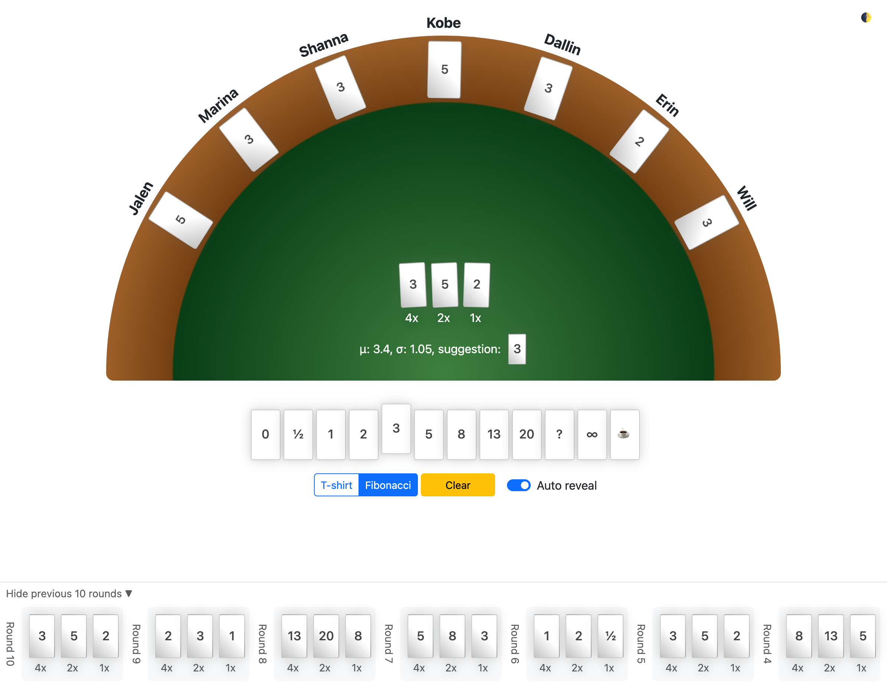

# Planning poker based on django-channels

 - No user management, just type a name and share the url.
 - 2 decks: T-shirt sizes & modified fibonacci.
 - No special admin roles: every participant can reveal, clear and change the deck.



# Local development
1. Create a virtual environment
1. Install the requirements: `pip install -r requirements.txt`
1. Apply the migrations: `./manage.py migrate`
1. Start a Redis server for backing storage: `docker run -p 6379:6379 -d redis:5`
1. Compile the JavaScript files: `npm run dev`
1. Run the server: `./manage.py runserver`
1. Navigate to http://localhost:8004/ to start a new session

If you want to run in production mode:
1. `npm run build`
1. `PRODUCTION=1 ./manage.py collectstatic --noinput`
1. `PRODUCTION=1 HOSTNAME=localhost ./manage.py runserver`

# Running with Docker
The image builds the JavaScript bundle, runs migrations on start and serves on port 8000 with `daphne`.
It needs a Redis server and a volume for the SQLite database in `/data`:

```
docker build -t poker .
docker run -p 8000:8000 -v poker-data:/data -e REDIS_HOST=<redis> -e HOSTNAME=localhost -e SECRET_KEY=<secret> poker
```

Set `HOSTNAME` explicitly: docker sets it to the container id by default.

# Deployment
CI builds and publishes `ghcr.io/jieter/planning-poker:latest` for every push to `master`. poker.datala.nl runs that
image with the compose setup in the `datala` repository (`compose/poker`), behind Caddy.

After pushing to `master`, run `./deploy.sh`: it waits for CI to succeed, pulls the new image and restarts the
stack on the server over SSH, and checks the site answers.
